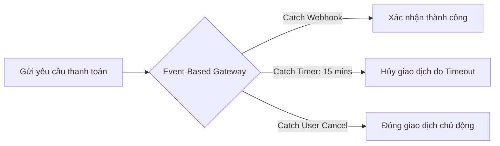

# BPMN 2.0 Collaboration Modeling Guide

Tài liệu này thiết lập bộ quy tắc chuẩn mực khi mô hình hóa quy trình nghiệp vụ bằng BPMN 2.0, phục vụ việc đối thoại chuẩn xác giữa BA, Product Team và Kỹ sư Hệ thống.

---

## 1. Ranh Giới Pool & Lane Semantics

> [!CRITICAL]
> **Quy tắc vàng của BPMN 2.0:**  
> - **Pool (Bể):** Đại diện cho một **Participant độc lập** (Tổ chức, Hệ thống độc lập, hoặc Actor bên ngoài như Khách hàng, Cổng thanh toán, Hệ thống Billing). Mỗi Pool có không gian điều khiển và bộ nhớ riêng biệt.
> - **Lane (Làn):** Chỉ là sự phân chia vai trò nội bộ **bên trong cùng một Pool** (ví dụ: Bộ phận Kế toán vs Bộ phận Chăm sóc khách hàng trong cùng công ty).

### Điều cấm kỵ (Violations):
1. **Sequence Flow nối giữa 2 Pool:** TUYỆT ĐỐI CẤM. Sequence Flow (mũi tên nét liền) chỉ được lưu chuyển nội bộ trong 1 Pool.
2. **Handoff giữa 2 Pool:** BẮT BUỘC dùng **Message Flow** (mũi tên nét đứt có hình tròn ở gốc).
3. **Black-box vs White-box Pool:** Các hệ thống bên thứ 3 (như Stripe, VNPay, Notification Service) nên được vẽ dưới dạng Black-box Pool (không cần vẽ chi tiết các bước bên trong, chỉ nhận và gửi Message).

---

## 2. Event-Driven Gateways & Timer Events

Trong hệ thống phân tán, thời gian và sự kiện bất đồng bộ là nguồn gốc của hầu hết các lỗi logic.

* **Event-Based Gateway:** Không đưa ra quyết định dựa trên dữ liệu có sẵn (như Exclusive Gateway), mà chuyển hệ thống vào trạng thái CHỜ SỰ KIỆN NÀO ĐẾN TRƯỚC.
* **Timer Catch Event:** Phải luôn có mặt khi hệ thống chờ phản hồi từ người dùng hoặc hệ thống bên ngoài để tránh treo tài nguyên vĩnh viễn (Deadlock/Zombie states).

---

## 3. Readability & Layout Rules

1. **Luồng chính (Happy Path) nổi bật:** Vẽ thẳng từ trái sang phải, ngang tầm mắt.
2. **Ngoại lệ (Exception/Recovery) nằm ở phía dưới:** Các luồng xử lý lỗi, retry nên rẽ nhánh xuống dưới rồi vòng ngược lại hoặc kết thúc ở Error End Event.
3. **Không đi dây chéo góc (Orthogonal routing only):** Tất cả connector chỉ được bẻ góc vuông 90 độ, không đi dây chéo cắt qua các task khác.
