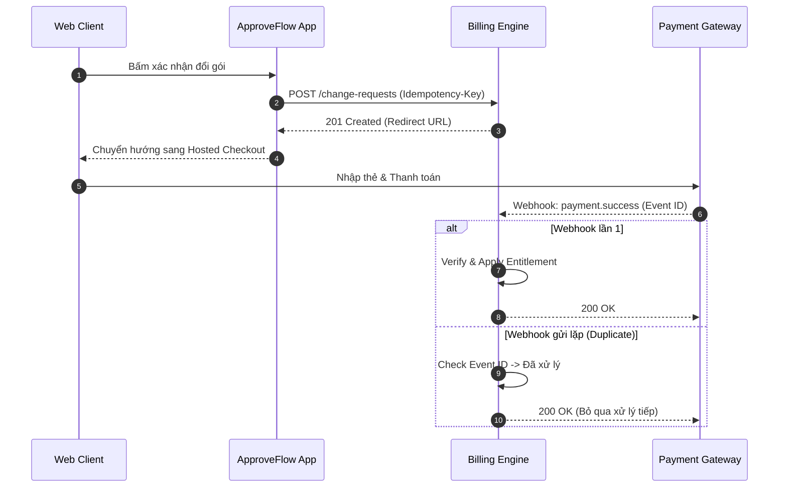

# Sequence Diagrams & Integration Contracts

Sequence Diagram giúp làm rõ trật tự thời gian và luồng trao đổi dữ liệu giữa các dịch vụ.

---

## 1. Đồng Bộ (Sync) vs Bất Đồng Bộ (Async)

* **Sync Interaction (Mũi tên nét liền, đầu nhọn đặc):** Gọi API và chờ phản hồi ngay lập tức (ví dụ: `POST /quotes` trả về thông tin giá trong vòng 200ms).
* **Async Interaction (Mũi tên nét liền, đầu hở):** Gửi yêu cầu và nhận mã `202 Accepted`; kết quả thực sự sẽ được trả về sau qua Webhook hoặc Polling.

---

## 2. Webhook Handling & Idempotency Loop

Khi tích hợp với bên thứ 3 (Payment Gateways, Shipping Partners):

### Các nguyên tắc vàng:
1. **Idempotency Key:** Mọi giao dịch tài chính phải gửi kèm khóa chống trùng lặp sinh ra từ Client.
2. **Duplicate Callback Resilience:** Hệ thống phải lưu log các Event ID đã nhận để bỏ qua các webhook bắn lặp từ cổng thanh toán.
