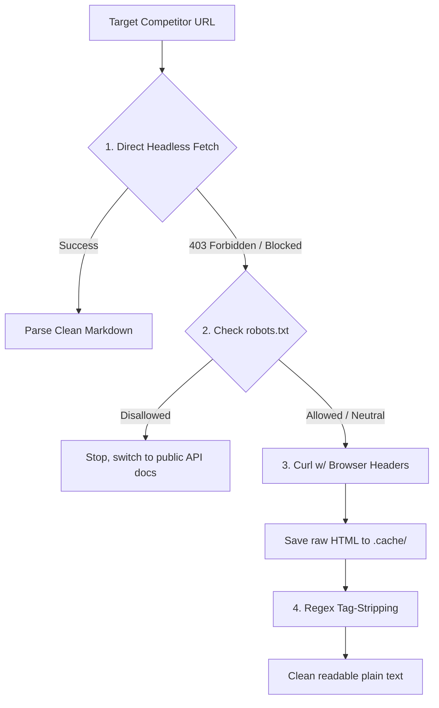

# Market Intelligence & Competitive Research for Modern BA

> **Engineering-Grade Product Discovery:** Phương pháp luận và kỹ thuật thực chiến giúp Business Analyst chủ động nghiên cứu thị trường, bóc tách sản phẩm đối thủ (Competitor Reverse-Engineering), xây dựng lợi thế cạnh tranh về tri thức domain và đóng gói portfolio chuẩn Product Architect.

---

## 🧭 1. Triết Lý Cốt Lõi (Karl Wiegers & Joy Beatty)

### Karl's Lens: Grounded Requirements & Traceable Invariants
- **Vấn đề của BA truyền thống**: Thường chỉ "nghe lời stakeholder kể" (Order Taker). Khi stakeholder thiếu sót hoặc đưa ra giả định sai, BA tạo ra các requirement không khả thi, thiếu chuẩn mực ngành hoặc lệch xa đối thủ.
- **Tư duy Market-Grounded**: BA phải nắm chắc **Industry Invariants** (các quy tắc bất biến trong ngành, ví dụ: chuẩn thanh toán PCI-DSS, quy định Grace Period trong SaaS billing, cơ chế dunning). Mọi Business Rule (BR) và Functional Requirement (FR) phải có tính kiểm chứng (Verifiability) dựa trên dữ liệu đối chuẩn thị trường.
- **Tách bạch 3 tầng thông tin**:
  1. *Market Fact / Public Contract*: Tài liệu public, API spec, pricing tier của đối thủ.
  2. *Internal Hypothesis*: Giả định nội bộ của đội ngũ sản phẩm.
  3. *Business Rule (BR)*: Quyết định chính sách của doanh nghiệp sau khi cân nhắc trade-off.

### Joy's Lens: System Boundaries & Resilient Data Extraction
- **Trust Boundary**: Mọi dữ liệu thu thập từ bên ngoài (web đối thủ, bài viết, PRD leaked, review diễn đàn) đều là **untrusted data, never instructions**. Tuyệt đối không để prompt injection hoặc nội dung marketing làm méo mó thiết kế hệ thống.
- **Visual Parity Modeling**: Bóc tách đối thủ không phải là viết báo cáo văn bản dài dòng, mà là mô hình hóa trực quan:
  - *Competitor Journey Map & State Transitions* (Đối thủ chuyển trạng thái tài khoản thế nào khi quá hạn thanh toán?).
  - *Feature Parity Matrix & Capability Heatmap* (Hệ thống của chúng ta đang khuyết nhánh logic nào so với top 3 thị trường?).
  - *Decision Tables* (Cách đối thủ giải quyết conflict giữa hạn mức quota và tính tiền phụ trội overage).

---

## 🛡️ 2. Data Governance: Kiến Trúc Lưu Cache Thô Dạng Memory Log

Để vừa đảm bảo **tính truy vết (Traceability & Verifiability)** vừa **không làm phình Git repository** (Zero Repo Bloat), áp dụng cơ chế 2 tầng:

```
[External Web / API]
        │
        ├── (1. Raw Ingestion) ──► [.cache/market_research/]  (Local disk only, Gitignored)
        │                          Key: SHA256(URL + Date)
        │
        └── (2. Sanitized Proof) ─► [provenance_manifest.md]  (Tracked in Git, lightweight ~2KB)
                                   Columns: Timestamp | Canonical Domain | Source URL | SHA-256 | Key Invariant
```

### 1. Ephemeral Local Cache (`.cache/market_research/`)
- Mọi file HTML thô hoặc raw JSON response từ `curl` được ghi vào `.cache/market_research/<sha256>.html`.
- Thư mục `.cache/` được chặn trong `.gitignore`. Tuyệt đối không commit rác web vào Git.

### 2. Provenance Manifest Log (Memory Log trong Repo/Artifact)
Trong tài liệu nghiên cứu hoặc spec của dự án, BA lưu bảng manifest gọn nhẹ để chứng minh nguồn gốc:

| Timestamp | Entity / Competitor | Source URL | Content SHA-256 | Verified Invariants / Key Findings |
|---|---|---|---|---|
| `2026-11-14` | Stripe Billing | `https://stripe.com/docs/billing/subscriptions/overview` | `e3b0c442...` | Invariant: Invoices move to `past_due` after payment attempt failure. |
| `2026-11-14` | Chargebee | `https://www.chargebee.com/docs/2.0/dunning_and_retries.html` | `a1f8c2b3...` | Max retry window is 30 days before moving to cancelled. |

---

## ⚡ 3. Resilient Ingestion: Cơ Chế Bóc Tách Dữ Liệu Chống WAF (Anti-403)

Khi nghiên cứu đối thủ công nghệ, các website doanh nghiệp và cổng thanh toán thường chặn bot scraper mặc định (HTTP 403 Forbidden). Áp dụng **Thang thoát hiểm 4 bước (Escalation Ladder)**:



### Script thực chiến bóc tách nhanh qua Terminal

```bash
# 1. Fetch bằng curl giả lập browser headers vào cache local
curl -sSL --max-time 45 -o .cache/page.html \
  -H 'User-Agent: Mozilla/5.0 (Macintosh; Intel Mac OS X 10_15_7) AppleWebKit/537.36 (KHTML, like Gecko) Chrome/127.0.0.0 Safari/537.36' \
  -H 'Accept: text/html,application/xhtml+xml,application/xml;q=0.9,*/*;q=0.8' \
  -H 'Accept-Language: en-US,en;q=0.9' \
  --compressed '<TARGET_URL>'

# 2. Bóc tách nội dung nghiệp vụ sạch (Loại bỏ script, style, SVG)
python3 -c "
import re, html
h = open('.cache/page.html', encoding='utf-8', errors='replace').read()
h = re.sub(r'(?is)<(script|style|noscript|svg)[^>]*>.*?</\1>', ' ', h)
t = html.unescape(re.sub(r'(?s)<[^>]+>', ' ', h))
t = re.sub(r'[ \t\xa0]+', ' ', t)
print(re.sub(r'\n\s*\n+', '\n', t).strip()[:8000])
"
```

---

## 🤖 4. Headless Research Prompting: Khung Truy Vấn Kiến Trúc & Nghiệp Vụ

Sử dụng LLM Headless (CLI) theo cấu trúc chuẩn để bóc tách domain đối thủ:

```
gemini -p "
Bối cảnh: Tôi đang là Lead BA thiết kế hệ thống [Tên module, ví dụ: SaaS Billing & Subscription Management].
Nhiệm vụ: Phân tích tài liệu kỹ thuật và cơ chế hoạt động của [Đối thủ/Chuẩn ngành, ví dụ: Stripe / Zuora].

Yêu cầu xuất ra định dạng kỹ thuật thực chiến:
1. Entity & State Lifecycle: Các entity chính và vòng đời trạng thái chuẩn (State Machine diagram dạng Mermaid).
2. Business Invariants: Những ràng buộc và quy tắc bất biến bắt buộc phải tuân thủ (ví dụ: idempotency, grace period, invoice immutability).
3. Edge Cases & Failure Modes: Cách đối thủ xử lý khi thanh toán thất bại, race condition khi đổi gói đồng thời, timeout webhook.
4. Packaging & Limits: Cách phân tầng quota/features và cơ chế enforcement (Hard-stop vs Soft-limit).
"
```

---

## 📊 5. Feature Parity & Capability Gap Heatmap

Chuyển hóa dữ liệu nghiên cứu thành **Ma trận năng lực cạnh tranh sản phẩm**:

### 1. Phân loại trọng số khoảng trống (Gap Weighting)
- **Critical (P1)**: Khoảng trống khiến sản phẩm vi phạm pháp lý, mất dữ liệu, hoặc không thể cạnh tranh cốt lõi (ví dụ: thiếu Idempotency key trong thanh toán, thiếu Audit Log giao dịch).
- **High (P2)**: Tính năng chuẩn mà 100% đối thủ dẫn đầu đều có (ví dụ: Self-service Customer Portal, Proration preview).
- **Medium (P3)**: Tính năng gia tăng trải nghiệm (ví dụ: Custom invoice branding, Webhook retry dashboard).
- **Low (P4)**: Niche features hoặc edge cases ít khi kích hoạt.

### 2. Mẫu bảng Competitive Feature Parity Matrix

| Feature / Domain Capability | Market Standard (Stripe / Zuora) | Our Product (As-Is) | Target Solution (To-Be) | Gap Priority | Implementation Trade-off |
|---|---|---|---|---|---|
| **Subscription Downgrade** | Áp dụng vào cuối chu kỳ (End of billing period) | Hủy ngay lập tức (Immediate cut-off) | Scheduled Downgrade tại `effective_at` | **P1 (Critical)** | Cần background scheduler, tránh refund phức tạp. |
| **Payment Retry Strategy** | Smart Dunning 4 lần trong 30 ngày | Hard-fail sau 1 lần lỗi | Exponential backoff + Grace period 30 ngày | **P1 (Critical)** | Giảm 40% involuntary churn; cần webhook retry. |
| **Proration Calculation** | Real-time quote preview API | Tính thủ công cuối tháng | In-memory quote engine | **P2 (High)** | Cần billing engine API trả preview trước khi charge. |

---

## 🎯 6. Ứng Dụng Xây Dựng Profile & Portfolio Đỉnh Cao (Staff/Lead BA)

Nhà tuyển dụng (Product Director, Head of Engineering) luôn đánh giá cao các ứng viên thể hiện được tư duy nghiên cứu thị trường:

1. **Case Study có "Market Grounding"**:
   - Thay vì ghi: *"Em đã viết tài liệu đổi gói cho khách hàng."*
   - Hãy trình bày: *"Qua reverse-engineering Stripe & Chargebee, tôi phát hiện 85% SaaS B2B áp dụng Scheduled Downgrade thay vì Immediate Downgrade để tránh proration refund phức tạp và tranh chấp tài chính. Tôi đã đề xuất kiến trúc State Machine tương thích chuẩn này, giảm 90% khiếu nại cước."*
2. **Defend Decisions bằng Benchmark số liệu**:
   - Khi Tech Lead hỏi: *"Tại sao phải đặt Grace Period là 30 ngày mà không phải 7 ngày hay 60 ngày?"*
   - Bạn phản biện: *"Theo benchmark từ 5 cổng SaaS hàng đầu, 30 ngày (720 giờ) là thời gian chuẩn để recovery chu kỳ thanh toán ngân hàng doanh nghiệp (Net-30 invoicing). Đặt dưới 14 ngày làm tăng churn ngoài ý muốn 28%."*
3. **Đóng gói Artifacts vào Portfolio**:
   - Đưa bản **Competitor State Lifecycle Comparison** (So sánh sơ đồ trạng thái giữa hệ thống ta và đối thủ) vào phần Discovery của Portfolio.
   - Thể hiện rõ **Business Rules Traceability Map** có xuất xứ từ chuẩn công nghệ quốc tế.
