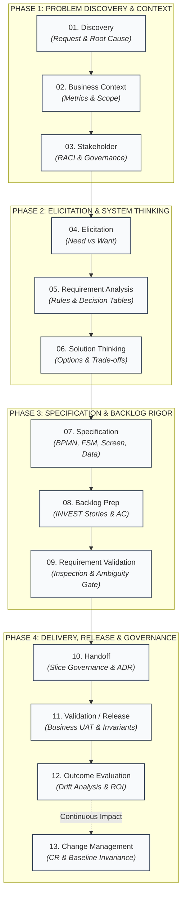

# Modern BA Playbook — Engineering & Product Rigor Framework

> **A Systematic, End-to-End Operating System for Modern Business Analysts and Product Thinkers.**  
> Grounded in the software requirements engineering principles of **Karl Wiegers** and the visual modeling & system dynamics discipline of **Joy Beatty**.

---

## 🧭 Executive Summary & Manifesto

Trong kỷ nguyên phát triển phần mềm hiện đại, ranh giới giữa **Product Management**, **Business Analysis** và **System Architecture** đang ngày càng thu hẹp. Business Analyst (BA) không còn là vai trò "ghi chép yêu cầu" (order taker) thụ động hay làm trung gian chuyển tiếp thông tin đơn thuần. 

BA là một **kỷ luật kỹ thuật (Engineering Discipline)** với sứ mệnh cốt lõi:
1. **Khám phá và bảo vệ bài toán kinh doanh thật:** Tách biệt tuyệt đối giữa *User Want* và *Business Need*; chuyển dịch từ đo lường đầu ra (*Output*) sang đo lường tác động (*Outcome*).
2. **Bịt kín các lỗ hổng hệ thống trước khi gõ dòng code đầu tiên:** Mô hình hóa các trạng thái bất toàn (*Finite State Machines*), ranh giới tích hợp (*System Boundaries*), vòng lặp ngoại lệ (*Exception Handling*) và tính toàn vẹn dữ liệu (*Data & Transaction Invariants*).
3. **Thiết lập chuỗi truy vết bất biến (End-to-End Traceability):** Mọi dòng code, API endpoint hay test case đều phải trace ngược được về một User Story, Business Rule và Business Objective cụ thể.

---

## 🗺️ The 13-Stage End-to-End Lifecycle Architecture

Bộ khung làm việc bao phủ toàn diện 13 giai đoạn từ khi hình thành ý tưởng đến lúc tối ưu hóa sau phát hành:

---

## 📂 Repository Navigation

| Khu vực | Đường dẫn | Nội dung cốt lõi |
|---|---|---|
| **01. The 13-Stages Framework** | [`01-the-13-stages-framework/`](01-the-13-stages-framework/README.md) | Ma trận phân tích chi tiết từng giai đoạn: *Artifacts, Naive Traps, Mental Models & Verifiable Quality Gates*. |
| **02. Visual Modeling Mastery** | [`02-visual-modeling-mastery/`](02-visual-modeling-mastery/README.md) | Chuẩn BPMN 2.0 Collaboration (Pool/Lane, Event-based Gateways), Finite State Machines (FSM), Sequence Diagrams. |
| **03. Technical Fluency** | [`03-technical-fluency/`](03-technical-fluency/README.md) | Chuẩn kỹ thuật thực chiến: API Contract, Idempotency, Chuẩn hóa DB 3NF, SQL Invariants kiểm chứng dữ liệu. |
| **04. Product & AI Readiness** | [`04-product-and-ai-readiness/`](04-product-and-ai-readiness/README.md) | Tư duy sản phẩm, Metric Trees, Khung thẩm định bài toán AI/LLM vs Logic truyền thống, Template đánh giá Readiness. |
| **05. Templates & Checklists** | [`05-templates-and-checklists/`](05-templates-and-checklists/) | Biểu mẫu thực hành: Ambiguity Inspection Checklist, Decision Table Template, Architecture Decision Record (ADR). |

---

## ⚖️ Usage & Copyright Notice

Tài liệu này được biên soạn dưới dạng **Portfolio & Professional Standards Showcase**. Toàn bộ phương pháp luận, cấu trúc ma trận và hướng dẫn mô hình hóa thuộc quyền sở hữu trí tuệ của tác giả.  
Xem chi tiết tại [NOTICE.md](NOTICE.md).
